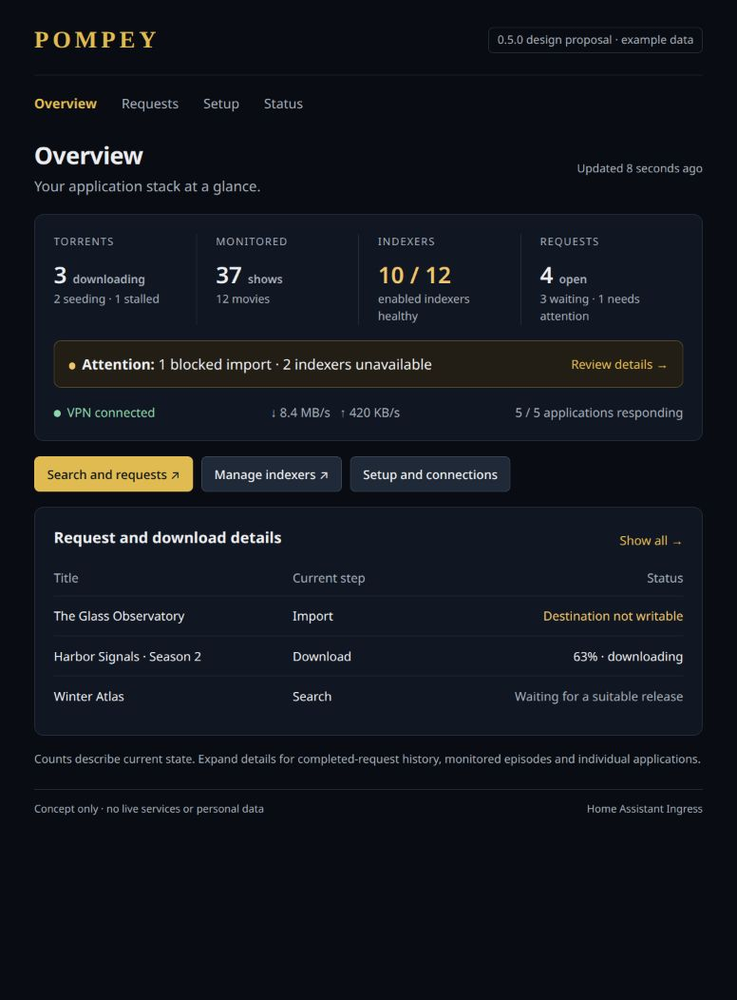
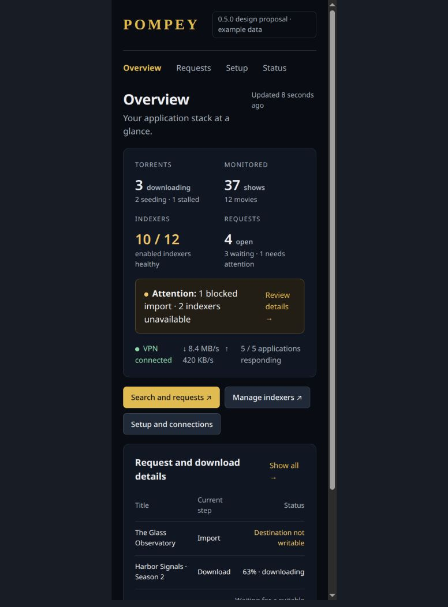
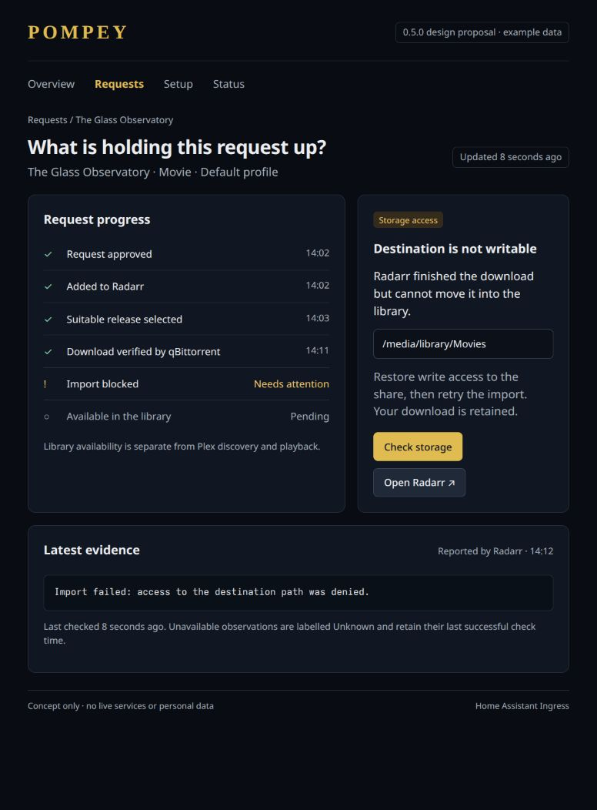
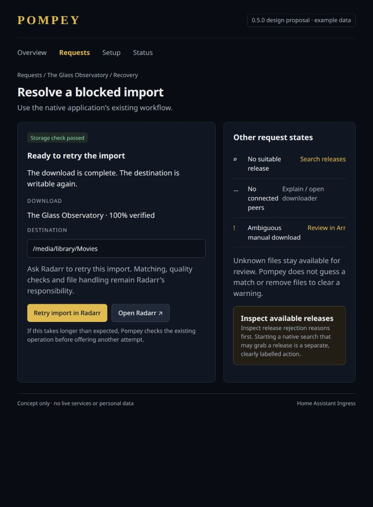
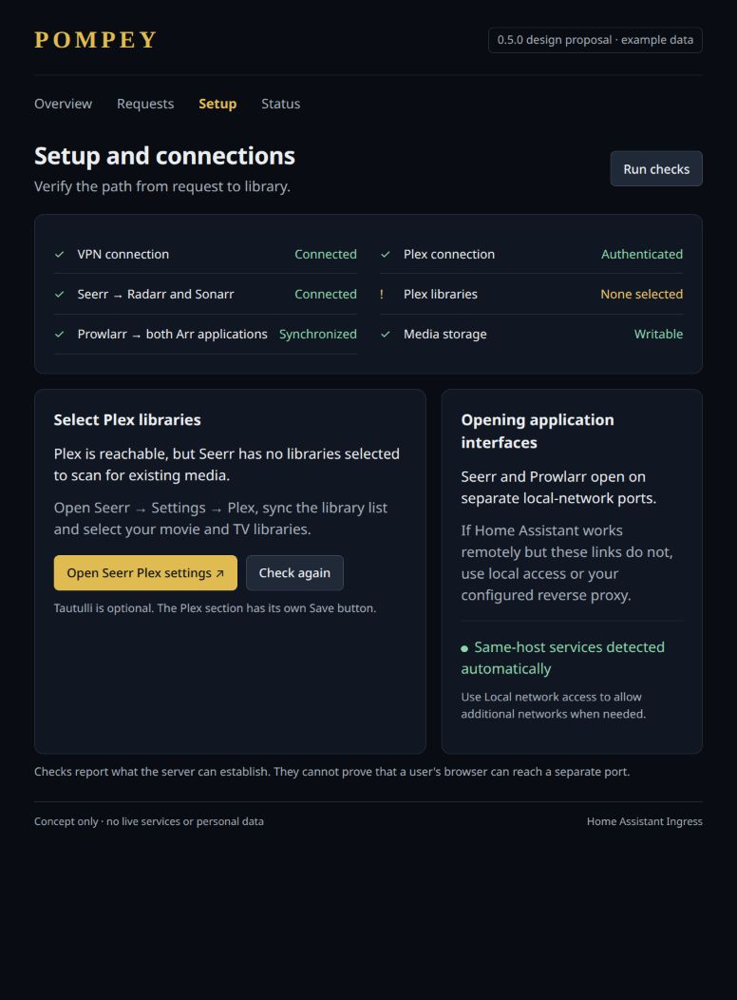
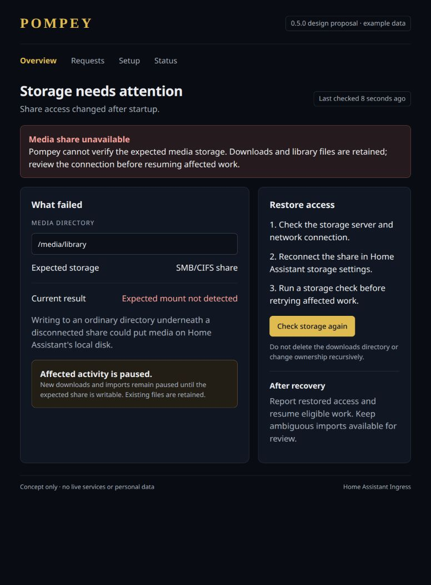
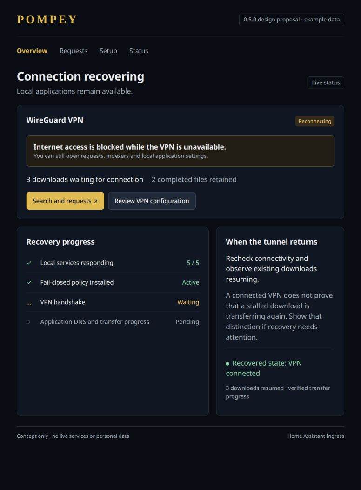
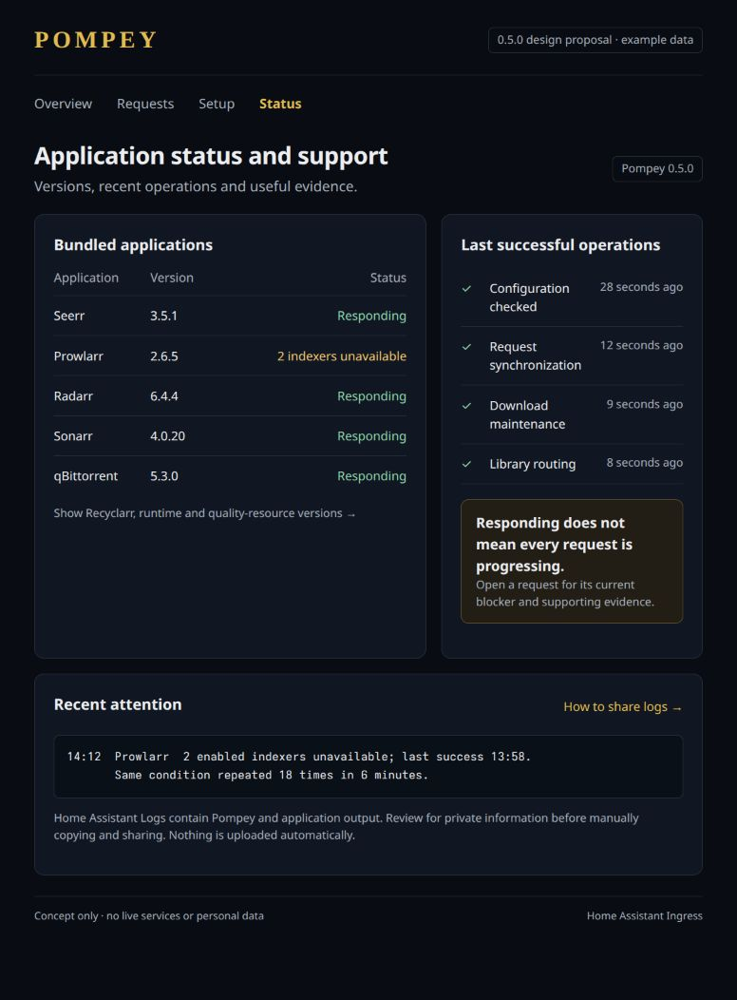

# Pompey 0.5.0 design proposals

These are planning mockups, not implemented product behavior. All titles, paths,
counts, timestamps and versions are illustrative. The screenshot badge makes that
distinction visible when an image is viewed outside its issue.

`index.html` contains the editable source. Serve this directory with a local HTTP
server and open `/?view=overview`, `diagnostics`, `recovery`, `setup`, `storage`,
`vpn` or `support`. Images in `images/` are browser screenshots of those views.

## Overview principles

- Show current counts with stable definitions: downloading, seeding and stalled
  torrents; monitored series and movies; healthy enabled Prowlarr indexers; and
  open Seerr requests with waiting and attention breakdowns.
- Torrent states must have documented, mutually exclusive buckets. A stalled
  transfer is not also counted as actively downloading.
- A monitored series is not a monitored episode, an incomplete season is not
  automatically a failed request, and library presence is not Plex playback.
- Do not make lifetime request completion totals the headline. Offer completed,
  declined and other history in expanded details. Keep source-specific status
  semantics explicit when computing open requests and needs-attention counts.
- Report unavailable and stale observations with their age. Never replace a
  failed query with zero or count one underlying problem repeatedly.
- Make counts useful for noticing discrepancies and opening the relevant
  details. Avoid displaying only green service-liveness indicators.
- Keep the summary compact, wrapping on narrow screens. Expanded details should
  preserve context without creating a second Arr administration interface.

## Safety and scope

Recovery actions use native application operations and their matching/quality
rules. An uncertain result must be reconciled before repeating a mutation.
Unavailable storage must not cause writes to a fallback local directory; any
claim that affected work is paused needs evidence from the real applications.
UI health claims describe observations, not an in-container reproduction of a
network packet test. The firewall's actual guarantees remain packet-tested.

Keep manual log sharing; there is no diagnostic upload or issue-attachment
service. Screenshots show proposed Pompey interfaces, not edits to upstream
Seerr or other application interfaces.

## Mockups

### Ecosystem overview

The narrow-screen preview uses a 390-pixel iframe in `mobile.html`:

### Per-request troubleshooting

### Targeted recovery

### Setup and connectivity

### Storage failures

### VPN recovery

### Status and support

