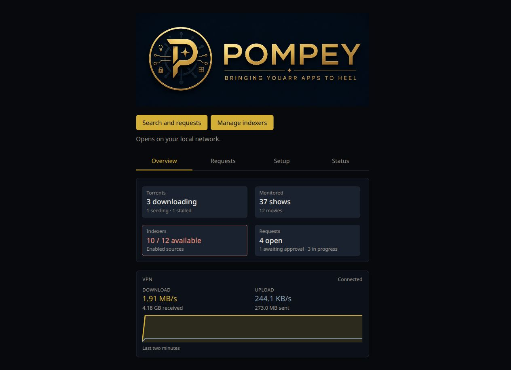
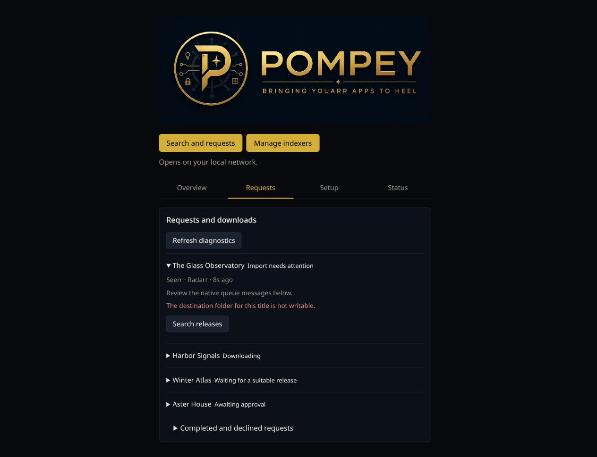
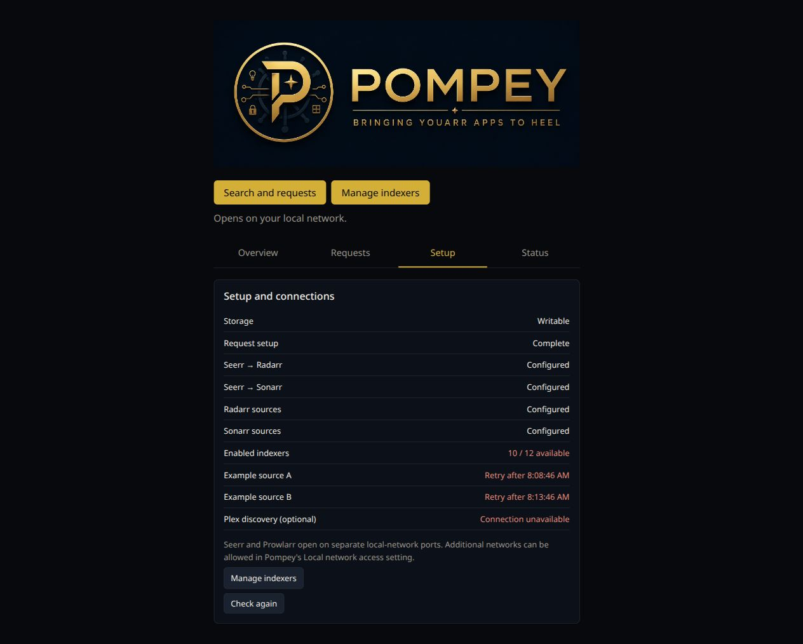
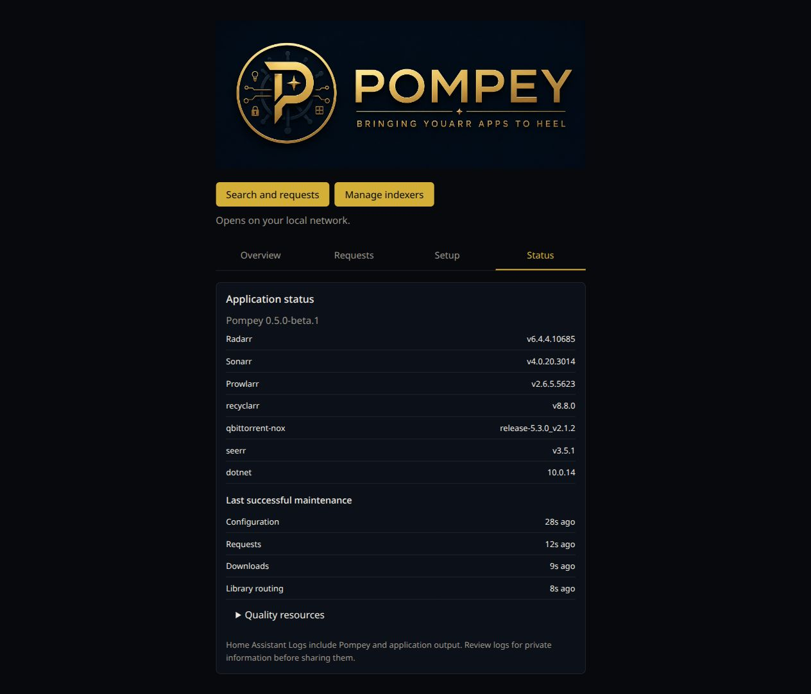
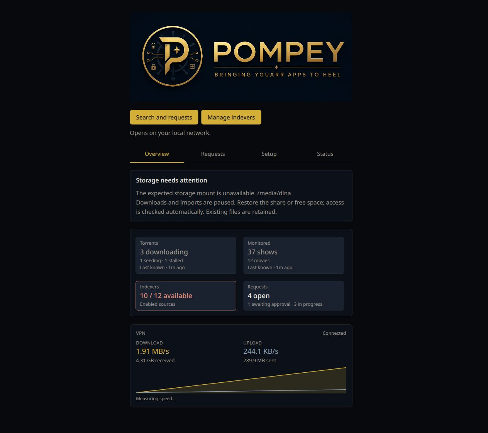
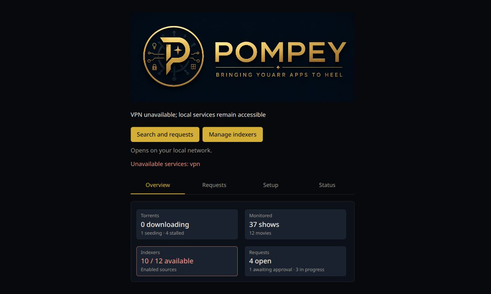

# 0.5.0 implementation review

**Development preview; stable-release approval is pending.** These are browser screenshots of the current product HTML, CSS and JavaScript, captured on October 27, 2026. They are not the earlier design mockups. All titles, counts, health responses, timestamps and failure messages are synthetic examples; application versions come from the current bundle manifest. No personal installation or production diagnostics are included.

**Home Assistant delivery:** the app store reads `main`, not GitHub release tags. Merging the beta version can offer that beta as an HA update. The beta merge is authorized after required CI. Stable 0.5.0 remains on hold for visual/release review; no stable 0.5.0 tag or release has been published.

The same screen code is shipped by Pompey. The preview supplies read-only status/diagnostic responses so failure states can be inspected without disrupting a real installation. Screenshots demonstrate presentation, not live application connectivity, recovery success or release acceptance.

## Overview

Overview is the default tab. Primary application links remain above the tab switcher. Counts open the matching detail tab; normal service totals stay out of the headline.

## Requests

The import-blocked request is expanded. Waiting, downloading, approval and completed/history states use the existing native-observation explanation rather than a separate controller state machine. Searches remain explicit. Advanced native-interface links are absent here because that option is disabled in the preview.

## Setup

This example shows two indexers in native backoff and an unreachable optional Plex connection. Configured Arr connections describe configuration; they are not proof that every downstream operation works. Other media servers remain optional supported choices.

## Status

Bundled versions, maintenance freshness and manual log-sharing guidance are visible. Pinned resource identities remain in the expandable Quality resources detail.

## Storage interruption

The contextual warning keeps Overview visible. Cached library/downloader counts retain their age and are labelled Last known. The production service hold and recovery have dedicated acceptance coverage, but periodic detection is not an atomic barrier against every fallback write. Interrupted native cleanup can still leave files for review.

## VPN interruption

The local application links remain available. This is the current, fairly basic outage presentation: it repeats the unavailable VPN in the status/error lines and does not implement the original mockup's detailed recovery timeline. The transfer-resumption guarantee is tested separately; a screenshot cannot prove it.

## Before calling the first stable 0.5.0 ready

- Review the implemented screens and decide whether the visible wording/layout needs another polish pass. These captures are supplied for that review; merging the beta development PR does not approve a stable release.
- Run full release acceptance, including the actual released-image upgrade, for the final release candidate. Fast local checks and submitted-PR core journeys serve different purposes.
- Complete or explicitly defer remaining issue criteria. Native blocked/setup/outage/history/direct-grab scenarios are not all implemented; per-request explanations and setup checks are useful increments, not every detail from the mockups. Targeted recovery mutations (#92) remain deferred to 0.6.0.
- Exercise the complete dependency discovery → PR → acceptance → merge → publication cycle. Repository permissions and protected CI are configured, but the beta intentionally keeps discovery inactive.
- Keep real Supervisor/HAOS, SMB/NAS behavior and media-server playback listed as unautomated boundaries. Required automated acceptance remains the release gate; this visual approval request does not restore a manual approval gate for every later dependency patch.
