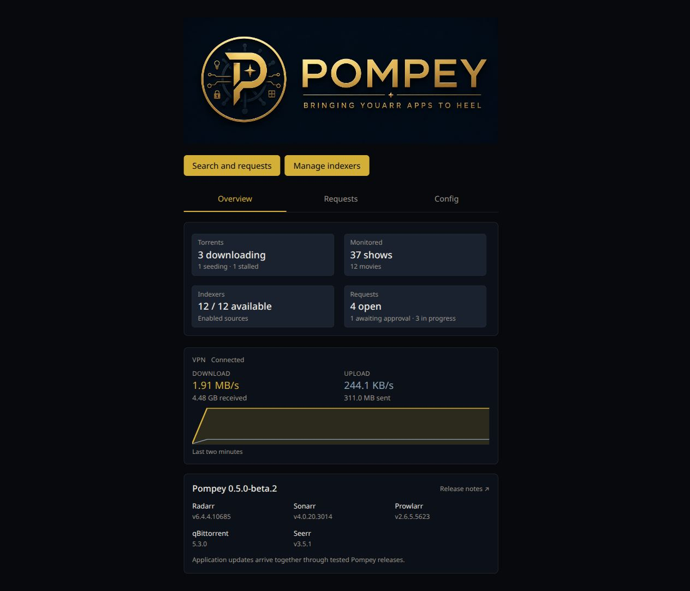
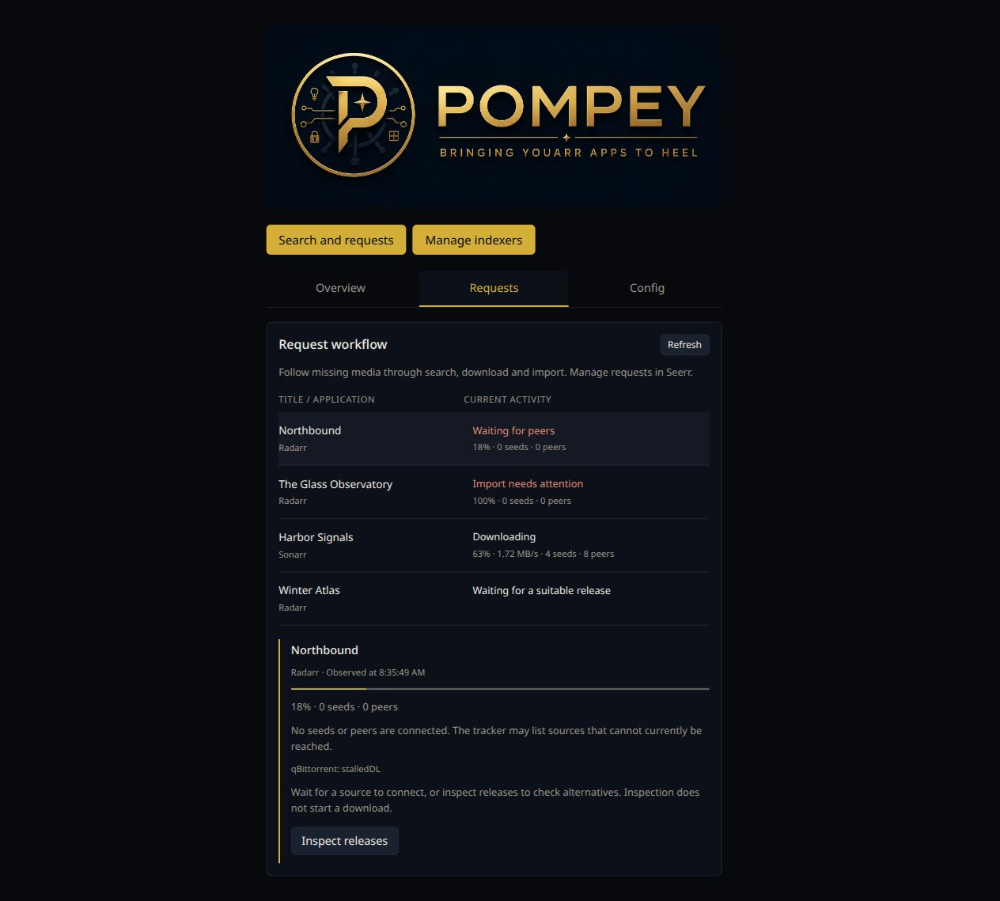
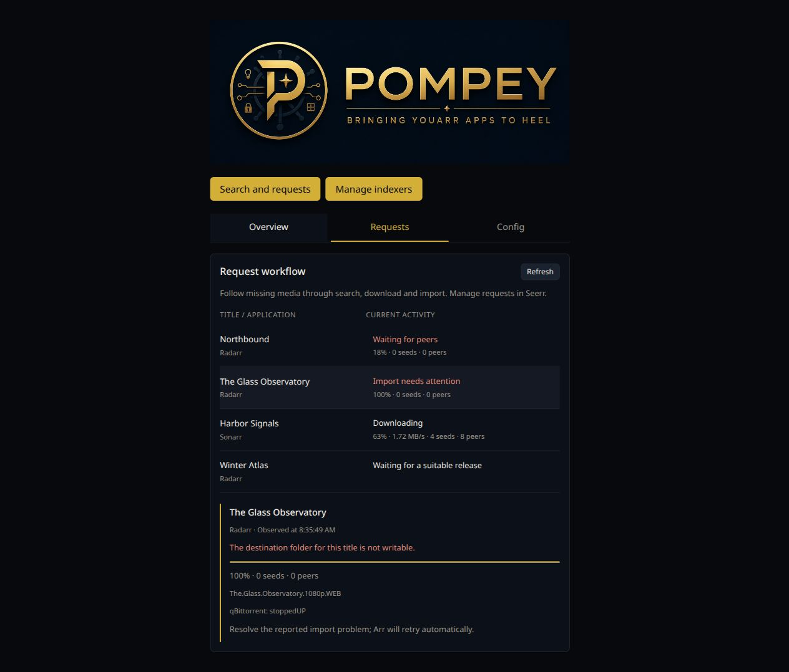
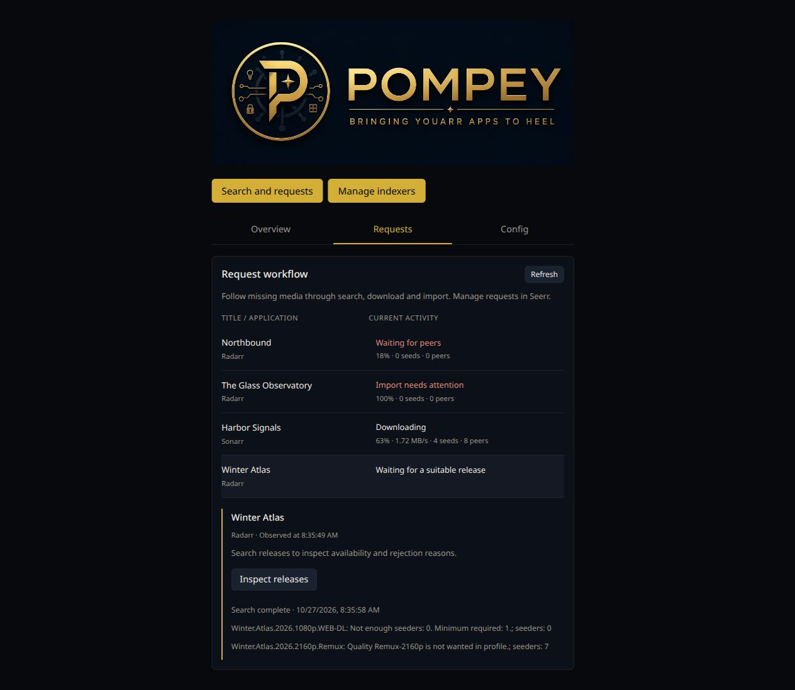
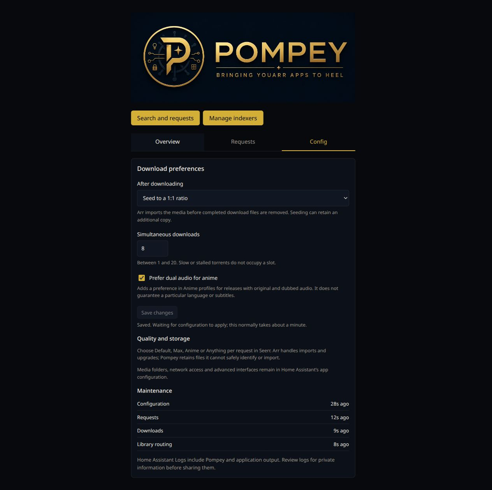
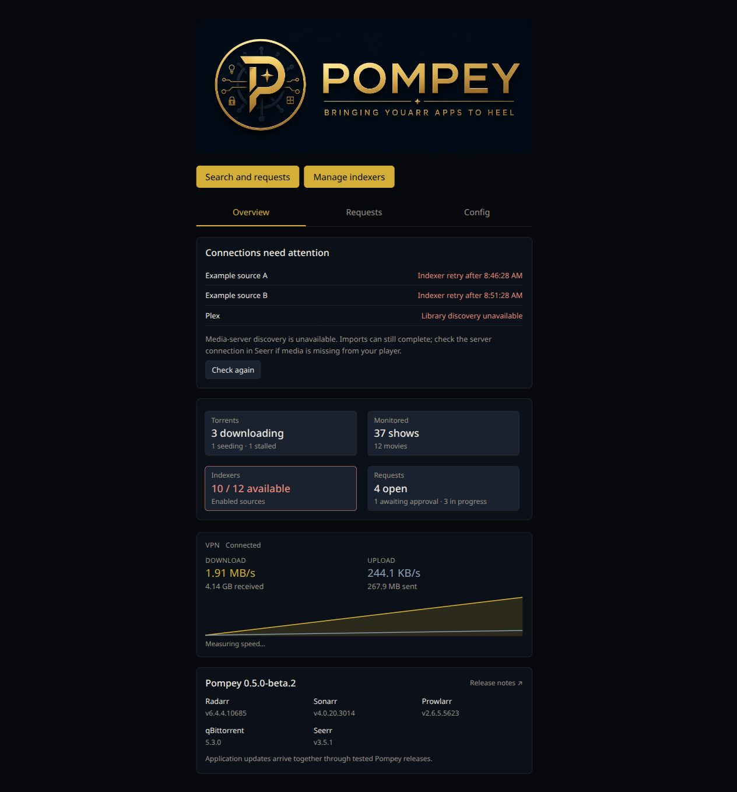
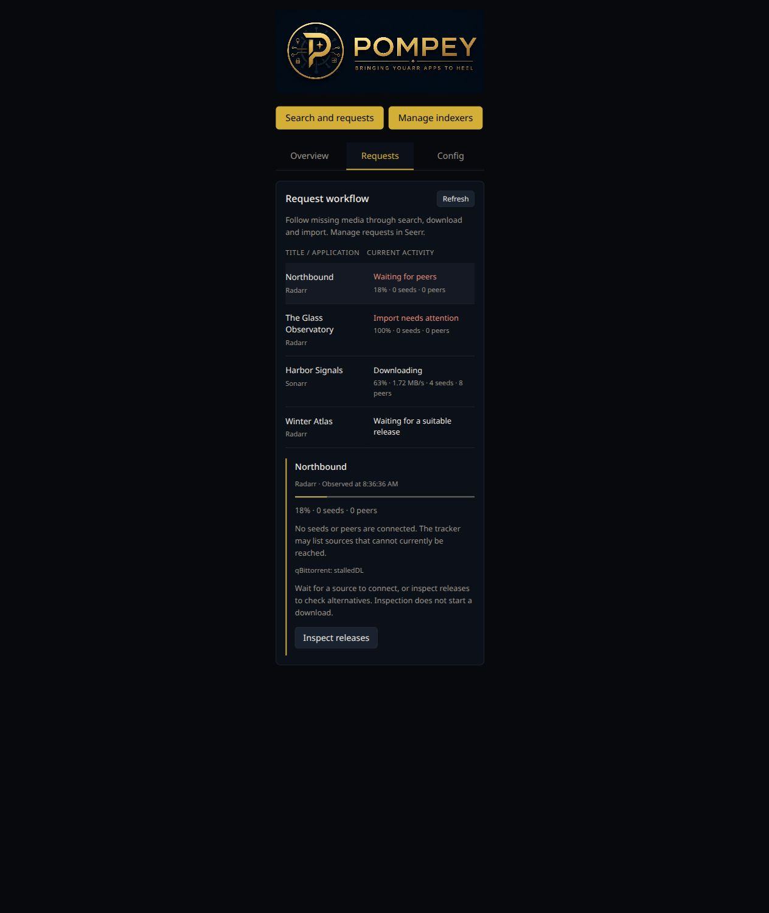

# 0.5.0 interface review

**Current implementation, with illustrative data.** These screenshots were captured on October 27, 2026 from the product HTML, CSS and JavaScript for 0.5.0-beta.2. Titles, counts, failures, timestamps and API responses are synthetic; bundled app versions come from the manifest. They demonstrate the interface, not production connectivity or release acceptance.

Home Assistant reads `main`, so a merged beta can be offered as an update. Beta delivery after required CI is authorized. **Stable 0.5.0 remains on hold for visual and release review.**

## Overview

The three tabs are Overview, Requests and Config. VPN connection state sits next to its label. Bundled application versions appear below current activity; runtime implementation versions are omitted. These are installed versions, not a claim that the latest upstream release has been checked. Release notes link to Pompey's releases, which deliver the tested bundle.

## Workflow inspection

Requests focuses on missing media and native Arr download/import queues rather than repeating Seerr's approvals and completed history. Each row selects an inspection area beneath the table. Progress, transfer speed and connected seeds/peers distinguish activity from stalled downloads. Work outside an Arr queue remains visible. This is an explicitly refreshed observation, not a historical trace or live peer connectivity test.

Native import messages remain visible. The interface explains that resolving the reported problem allows Arr's normal retries to continue; it does not add a second import controller.

Inspect releases performs an explicit search and shows native rejection reasons. It does not grab a replacement, remove a torrent or alter quality settings. Advanced native interfaces remain optional for operations such as inspecting or resuming a stopped torrent.

## Config

Seeding, concurrency and the existing Anime dual-audio preference are actual persisted controls. Config distinguishes saved preferences from a successful controller application; unavailable services can leave them pending. Normal reconciliation applies qBittorrent preferences and resynchronizes quality profiles when the audio preference changes. Media paths, network access and advanced interfaces stay in Home Assistant. Legacy HA behavior options are accepted until the first Ingress save.

The capture shows saved feedback using the preview's simulated response. The real handler's validation, persistence and invalid-write behavior were checked separately; this image does not prove an Arr/Recyclarr integration run with changed preferences.

## Contextual connection checks

There is no permanent Setup tab. Incomplete setup or connection problems reveal a contextual panel; successful checks are omitted. Optional media-server discovery failures do not imply that imports cannot work. Storage interruption retains its separate cross-tab warning and existing service hold behavior.

## Narrow layout

The same table works in a 390-pixel preview frame without turning rows into collapsible cards.

## Validation and remaining product gaps

- Fast local syntax, safety logic, harness and CI policy checks took 1.7–2.4 seconds including tool startup in this iteration. A direct loopback exercise of the real preferences HTTP handler verified persistence and rejection of invalid writes. Browser inspection covered desktop/narrow layouts, row selection, explicit searches and save feedback. PR core journeys and packet isolation run in CI; full release acceptance was not run for this visual iteration.
- The UI exposes native blockers and peer activity, not a durable history of all pipeline transitions. Diagnostics warn when the first 100 Arr queue entries or most recent Seerr requests are truncated. Request history remains in Seerr.
- Redownload-loop detection and a read-only inventory of orphaned files remain gaps. Maintenance success, retained-file policies and existing cleanup acceptance are not proof that no junk or repeated work exists on an installation. Avoid a misleading green “all clean” claim.
- Targeted recovery mutations (#92) remain deferred. Explicit release inspection, native automatic retries and optional advanced interfaces are the available tools; an inspected acceptable release is not automatically grabbed.
- Before stable approval, run full release acceptance with the actual released-image forward upgrade and resolve or explicitly defer remaining issue criteria. Real Supervisor installation, SMB/NAS behavior and media-player playback remain unautomated boundaries. The first dependency discovery → acceptance → publication cycle also remains outstanding; discovery intentionally stays inactive on beta versions.
